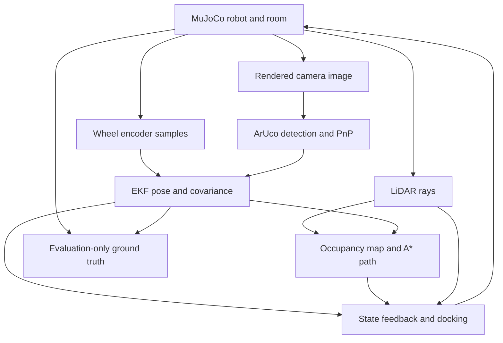
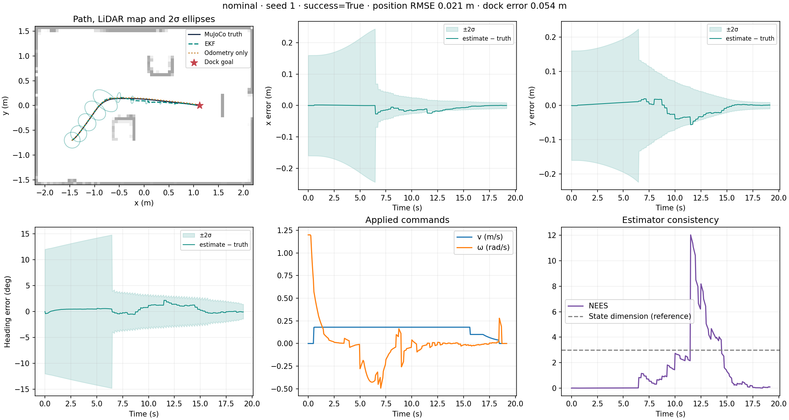

# Integrated Project — Track A

A combined, runnable version of the supplied Part A, Part B, Part C, Part D,
TurtleBot and Environment packages. The robot is the supplied **TurtleBot3
Waffle Pi**, simulated in MuJoCo. It builds an obstacle map from 2-D LiDAR,
navigates to the charging station and confirms its final pose using a rendered
ArUco marker.

The runtime uses one Python process. **ROS and Swift are not required.**
The original section code is preserved in `reference_sources/` for comparison.

## Start here — Windows

Extract the complete ZIP. Open a terminal in the folder containing this README
and `main.py`. Use a separate virtual environment to avoid conflicts with your
Industrial Robotics / Swift installation.

```powershell
py -3.12 -m venv .venv
.\.venv\Scripts\python.exe -m pip install -r requirements.txt
.\.venv\Scripts\python.exe main.py
```

This opens the MuJoCo viewer and runs the nominal trial. The terminal reports
navigation states. After completion the window closes and results are saved to
`results/nominal_seed1/`. The goal is shown as a star in the results plot.

To run without a window:

```powershell
.\.venv\Scripts\python.exe main.py --headless
```

The single launcher is `main.py`. Keeping only one filename avoids a
`Main.py`/`main.py` collision on Windows. All model and asset paths are resolved
relative to the project; running from a different working directory is supported.

## Linux / macOS

```bash
python3 -m venv .venv
source .venv/bin/activate
python -m pip install -r requirements.txt
python main.py --headless
```

For a Linux desktop viewer, run `python main.py`. On macOS the passive MuJoCo
viewer requires the `mjpython` launcher: `mjpython main.py`. The headless Linux
command selects EGL unless `MUJOCO_GL` is already set. It still renders camera
images: **headless does not bypass vision**. EGL must be supported by the local
graphics driver. If it is unavailable, use a supported desktop graphics context
or install/configure MuJoCo's OSMesa backend and set `MUJOCO_GL=osmesa`.

Tested here with Python 3.12 and Linux/EGL; exact tested package versions are in
`requirements-tested.txt` and each run's `run_config.json`. The Windows and macOS
commands are provided for setup; those operating systems were not tested here.

## Useful commands

Use your virtual environment's Python for these commands.

```bash
python main.py --headless --scenario noisy --seed 2
python main.py --headless --scenario dropout --seed 1
python main.py --headless --scenario disturbed --seed 1
python main.py --headless --duration 65 --output results/my_trial
python part_a_check.py
python calibrate.py
python evaluate.py --seeds 1 2 3 --duration 65
python -m pip install -r requirements-dev.txt
python -m pytest -q
```

Exit status `0` means the trial met the evaluation criteria. Status `2` means it
did not: inspect the saved metrics and plot. A timeout is recorded as a failure.
Closing the viewer also saves an unsuccessful partial run. Ctrl+C closes the
simulation immediately; that interrupted run is not saved.

The negative check below deliberately disables the camera. It should reach the
vicinity of the station but **must not declare visual docking complete**. Exit
status `2` is expected:

```bash
python main.py --headless --scenario no_camera --duration 25
```

## What is connected



The EKF, camera processor, planner and controller have no simulator handle.
`SensorPacket` contains time, wheel angles, ranges and an RGB image. Simulator
pose is available only in the backend that emulates sensors, offline calibration,
and the evaluation/logger layer. The controller's completion decision uses its
estimated pose and recent accepted camera measurements. True pose is checked
afterwards to decide whether the trial actually succeeded.

## Where to edit each section

| Supplied section | Integrated file(s) | Responsibility |
|---|---|---|
| Part A | `track_a/model.py`, `part_a_check.py`, `calibrate.py` | Midpoint motion model, Jacobians, wheel conversion, rank and model checks |
| Part B | `track_a/frames.py`, `track_a/noise.py`, `track_a/sensing.py` | Frame transforms, scan handling, ArUco detection, camera covariance |
| Part C | `track_a/estimation.py` | Encoder prediction and camera EKF correction |
| Part D | `track_a/controller.py`, `track_a/planning.py` | State feedback, LiDAR path planning, docking states |
| Environment | `track_a/scene.py`, `track_a/simulator.py` | Room, obstacles, marker, MuJoCo dynamics and sensor acquisition |
| TurtleBot | `models/robotis_tb3/` | Waffle Pi meshes, adapted robot XML and original model licence |
| Integration / Part E | `track_a/runner.py`, `track_a/evaluation.py`, `evaluate.py` | Scheduling, repeatable trials, logs, figures and metrics |
| Shared parameters | `track_a/config.py` | Units, dimensions, gains, mounts, noise and scenarios |

`track_a/scene.py` builds the scene from the robot XML at runtime. There is no
second, conflicting `Scene.xml` to keep synchronised. Original placeholder and
ROS files are in the reference folder and are not imported by the application.

## Parameters and frames

All distances are metres, angles are radians and time is seconds. Positive yaw
is counterclockwise. Wheel order is **left, right**. MuJoCo quaternions use
**w, x, y, z**.

| Item | Default | Reason / interpretation |
|---|---|---|
| Robot | Waffle Pi | Matches the supplied Part A validation model |
| Wheel radius / separation | 0.033 / 0.288 m | Explicit contact geometry and axle positions; independently validated |
| Physics / control steps | 0.002 / 0.05 s | 25 physics steps per controller step |
| LiDAR | 180 rays, 10 Hz, 3.5 m | Full planar scan with independent range noise |
| Camera | 480 × 360, 4 Hz, vertical FOV 58° | Actual MuJoCo RGB rendering |
| Marker | `DICT_4X4_50`, ID 7, side 0.24 m | Known oriented landmark at the station |
| Wheel limit | 7.88 rad/s | Waffle Pi actuator limit from supplied XML |
| Speed / yaw rate limits | 0.18 m/s / 1.2 rad/s | Conservative operating limits for this scene |
| Feedback gains | k1 = 0.8, k2 = 2.0, k3 = 1.8 | Tuned by integrated runs; not claimed optimal |
| Planning radius + margin | 0.235 + 0.09 m | Conservative footprint about the axle plus clearance |
| Start | (−1.45, −0.70, 0) | Configured prior, not read from true pose during navigation |
| Dock target | (1.12, 0, 0) | A virtual docking pose 0.48 m in front of the marker |

The docking goal is a **stand-off alignment target**. There is no electrical
charging or mechanical contact model. The robot must be within 0.055 m and 5°
according to its estimate, with an accepted marker observation no older than
0.75 s, for 0.5 s continuously. Evaluation independently requires true position
error ≤ 0.08 m, true heading error ≤ 8°, zero collisions and a completed visual
confirmation. Changing these tolerances changes the task definition.

| Frame | Axes / transform |
|---|---|
| W — world | x/y on the floor, z up |
| B — base | x forward, y left, z up; origin at axle projection |
| C — OpenCV optical camera | x right, y down, z forward |
| L — LiDAR | x forward, y left, z up; fixed offset from B |
| M — marker | x points world −y, y world +z, outward normal world −x |

`T_parent_child` maps child coordinates into the parent. Camera localisation uses
`T_W_B = T_W_M @ inverse(T_C_M) @ inverse(T_B_C)`. See
[`docs/DESIGN.md`](docs/DESIGN.md) for equations, Q/R, observability and controller
behaviour.

## Results and what they mean

Every completed run saves:

| File | Contents |
|---|---|
| `log.csv` | True / estimated / odometry / reference poses, covariance, inputs, mode, NIS, NEES |
| `metrics.json` | Success, collision count, estimator errors, docking errors, control effort |
| `run_config.json` | Complete parameters, scenario, seed and package versions |
| `summary.png` | Path/map, truth and estimate, uncertainty bands, commands and NEES |
| `camera.png` | Most recent accepted marker image, or first image if none accepted |
| `map.npz` | Occupancy log odds, final planned path, grid resolution and origin |

The supplied results were generated from this code. See
[`docs/TEST_RESULTS.md`](docs/TEST_RESULTS.md) for measured outcomes and exact
commands. `reference_tracking_rmse_m` measures the distance to the moving
lookahead reference; it includes the deliberate lookahead separation. It is
**not a cross-track RMSE against a fixed trajectory**.



The default tests use a known room boundary, a known marker transform and a
known initial pose with uncertainty. Obstacles are discovered from LiDAR; their
true positions are not passed to the planner. This is not SLAM or global
relocalisation from an arbitrary unknown starting pose. A* replans every 0.5 s;
unknown space is provisionally traversable, with observed obstacle inflation
and a local range stop. Dynamic crowds, moving obstacles, severe wheel slip,
real lens distortion and hardware are outside the tested scope.

## Provenance, prior class work and declarations

The merge preserves and adapts the supplied Part A midpoint model, Part B frame
and noise utilities, Part C EKF structure, and Part D body-frame feedback law.
The camera pipeline, LiDAR acquisition/planning, simulator adapter, scheduler,
robustness runner and missing connections were added. Numerical, frame,
contact-model and controller faults were corrected. The complete change map is
in [`docs/INTEGRATION.md`](docs/INTEGRATION.md).

Relevant prior Industrial Robotics context was retrieved: frame conventions,
separating environment/model/motion logic, collision considerations, Jacobian
checks and dependency/path issues. **The full prior chat and all original lab
files were not available.** This project does not claim to reproduce or audit
every earlier exercise. The separate KUKA/UR3e tyre-removal code was not imported
into this TurtleBot project. See [`docs/CLASS_CONTEXT.md`](docs/CLASS_CONTEXT.md).

**Generative AI declaration:** OpenAI ChatGPT/Codex assisted with reviewing and
integrating the supplied code, completing missing interfaces and simulation
components, diagnosing faults, writing tests/documentation, and running the
reported evaluation. The team must review and understand the implementation and
record its own contributions before submission. Do not claim unperformed
hardware work or present these tests as proof of performance in all conditions.

**Contribution statement:** Team member names and their actual contributions
were not provided. Add an accurate statement before submitting the project.
The five-minute demo video and GitHub publication are also still team
deliverables; this package does not invent or publish either of them.

The supplied ROBOTIS assets retain their Apache 2.0 licence in
`models/robotis_tb3/LICENSE`. See `NOTICE.md` and the source manifest.
